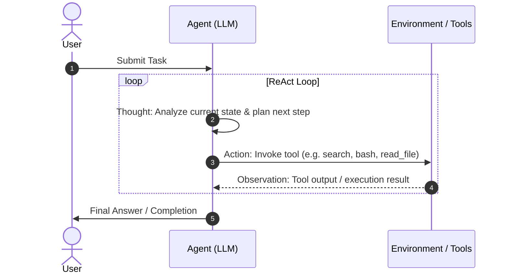

# ReAct: Synergizing Reasoning and Acting

> **Definition**: ReAct is an agentic design pattern that interleaves **verbal reasoning traces ("Thought")** with **domain-specific actions ("Action")**, followed by **environmental feedback ("Observation")**.



---

## 1. Why ReAct Works

Prior to ReAct, language models operated in two fragmented modes:
1. **Reasoning Only (Chain-of-Thought)**: Suffered from internal hallucination because the model could not verify facts or check intermediate states against the real world.
2. **Acting Only (Action-generation)**: Lacked strategic foresight; the model reacted blindly without forming a mental model of sub-goals.

ReAct unites both:
- Reasoning traces update the agent's internal plan, track anomalies, and adjust expectations.
- Actions ground the reasoning traces in actual external reality (retrieving documents, executing code).

---

## 2. Typical Trace Structure

```text
Question: What is the elevation of the town where author X was born?
Thought 1: I need to find the birthplace of author X.
Action 1: search("author X birthplace")
Observation 1: Author X was born in Springfield, Vermont.
Thought 2: Now I need to find the elevation of Springfield, Vermont.
Action 2: search("elevation of Springfield Vermont")
Observation 2: Springfield, Vermont is at an elevation of 410 ft (125 m).
Thought 3: I have found the answer.
Final Answer: Author X was born in Springfield, Vermont, which has an elevation of 410 ft (125 m).
```

---

## 3. Trade-offs & Failure Modes

- **Infinite Loops**: When an action consistently returns errors, an unconstrained ReAct agent may repeatedly attempt the same action with negligible variation. (Solved by reflection and cycle detection in frameworks like `[[wiki/frameworks/langgraph|LangGraph]]`).
- **Context Bloat**: Verbose observations (e.g., full shell outputs) quickly saturate the context window, stressing `[[wiki/concepts/agentic-memory|Agentic Memory]]`.
- **Latency & Cost**: Sequential tool invocation multiplies API costs and response times compared to parallel function calling.

---

## Cross-References
- Foundational Context: `[[wiki/syntheses/ai-agent-anatomy|The Anatomy of an AI Agent]]`
- Tool Execution: `[[wiki/concepts/tool-use-and-function-calling|Tool Use & Function Calling]]`
- Orchestration: `[[wiki/frameworks/langgraph|LangGraph]]`
