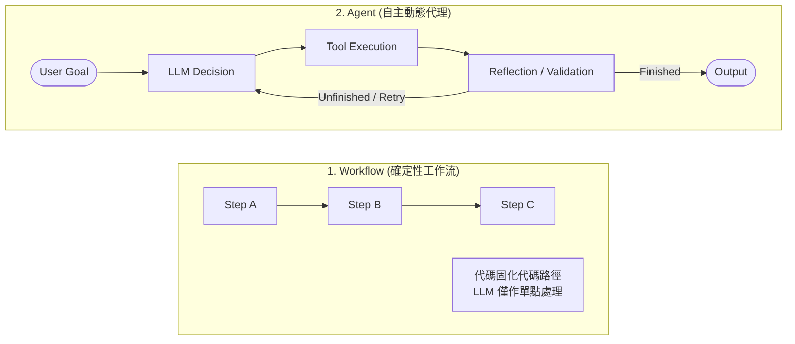

# Workflows vs. Agents: 確定性工作流 vs. 自主動態系統

> **核心分水嶺**：Anthropic 與 LangGraph 均指出，構建有效的 AI 系統時，首要決策是區分 **Workflow（工作流）** 與 **Agent（代理人）**。高效能系統往往不是盲目追求極致複雜的無序自主性，而是將簡單、可組合的設計模式落實於恰當的控制層級。

---

## 1. 架構對比 (Architectural Comparison)

| 維度 | Workflow (工作流) | Agent (代理) |
| :--- | :--- | :--- |
| **執行路徑** | 固定的 DAG（有向無環圖），由工程師預先編程決定 | 動態決定，LLM 自主評估下一步該採取什麼行動 |
| **控制權** | 程式碼掌控全局（Code-driven） | 模型掌控即時決策權（Model-driven） |
| **錯誤處理** | 傳統例外處理（Try-Catch、預設 Fallback） | 自我反思與修正（[[wiki/architectures/react-pattern|ReAct Loop]]、反饋驗證） |
| **適用場景** | 高確定性任務、批次數據處理、低容錯標準業務管道 | 探索型任務、多步驟複雜除錯、不確定性環境、工具協調 |
| **代表技術** | 基本 LangChain 鏈、經典數據管道 | `[[wiki/frameworks/langgraph|LangGraph]]`、AutoGPT、OpenAI Agents |

---

## 2. 工業巨頭的核心共識

### A. Anthropic 的觀點 (Building Effective Agents)
- **有效性原則**：不要過度工程化（Do not over-engineer）。最成功的實踐通常來自於「簡單且可組合」的模式。
- **四大核心能力**：
  1. `Planning`（任務規劃）
  2. `Tool Use`（工具調用，參見 `[[wiki/concepts/tool-use-and-function-calling|Tool Use]]`）
  3. `Reflection`（自我檢查）
  4. `Evaluation`（結果驗證）

### B. OpenAI 的觀點 (Practical Guide to Building AI Agents)
- Agent 的核心不是「聊天對話（Chat）」，而是「**工作流程管理（Workflow Management）**」與「**自主性（Autonomy）**」。
- Agent 的閉環路徑：
  $$\text{User Goal} \longrightarrow \text{Planning} \longrightarrow \text{Tool Selection} \longrightarrow \text{Execution} \longrightarrow \text{Validation} \longrightarrow \text{Output}$$

---

## 3. 混合架構：以 Graph 統一工作流與循環

`[[wiki/frameworks/langgraph|LangGraph]]` 提供了兼顧兩者的最佳折衷：
- 允許開發者在圖結構中定義確定性的節點（Node），但在節點之間透過條件邊（Conditional Edge）交由 LLM 作出動態決策與反覆重試。
- 實現「**在結構化約束下發揮自主性（Constrained Autonomy）**」。

---

## 相關筆記
- 基礎架構總覽：`[[wiki/syntheses/ai-agent-anatomy|The Anatomy of an AI Agent]]`
- 循環機制：`[[wiki/architectures/react-pattern|ReAct Pattern]]`
- 編排框架：`[[wiki/frameworks/langgraph|LangGraph]]`
- 編排核心：`[[wiki/concepts/agent-orchestrator|Agent Orchestrator]]`
