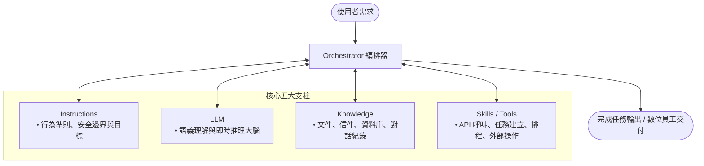

# Agent Orchestrator: 協調智慧、知識與行動的編排引擎

> **定義**：在現代工業級 Agent 架構中（尤其是 Microsoft 與 OpenAI 體系），**Orchestrator（編排器）** 是系統的總調度大腦。它串接 Prompt Instructions、LLM 推理、企業知識庫與執行技能，動態決定系統下一步的動作並監控任務執行狀態。

---

## 1. Microsoft 的經典 Agent 公式

在 Microsoft 的架構指南中，Agent 被明確拆解為 5 大核心組成元件：

$$\mathbf{Agent} = \text{Instructions} + \text{LLM} + \text{Knowledge} + \text{Skills} + \mathbf{Orchestrator}$$

---

## 2. Orchestrator 的四大關鍵職責

1. **狀態追蹤 (State Management)**：
   - 記錄當前任務進度、子目標達成情況與過去歷史對話（參見 `[[wiki/concepts/agentic-memory|Agentic Memory]]`）。
2. **決策與工具調度 (Tool Selection & Routing)**：
   - 根據使用者目標與環境反饋，決定是該檢索內部 Knowledge，還是調用外部 Skill（參見 `[[wiki/concepts/tool-use-and-function-calling|Tool Use]]`）。
3. **驗證與自主修正 (Validation & Error Recovery)**：
   - 判斷執行結果是否符合預期，若失敗則重新規劃路徑（OpenAI 所強調之核心能力）。
4. **多 Agent 協同分流 (Multi-Agent Dispatching)**：
   - 如 Microsoft Copilot Studio 指出，Agent 不僅調用 API，更能呼叫其他專業 Agent 分工處理複雜企業業務。

---

## 3. 企業級落地定位：數位員工 (Digital Employee)

Microsoft Copilot Studio 與 OpenAI 將 Agent 視為企業的「數位員工」：
- **Reasoning**：處理跨部門、多步驟的不確定業務。
- **Automation**：自動化例行文件生成與排程。
- **Action**：透過授權 API 與內部 ERP/CRM 系統即時互動。
- **Memory**：保留跨會話的企業上下文與專案進度。

---

## 相關筆記
- 巨頭工作流對比：`[[wiki/architectures/workflows-vs-agents|Workflows vs. Agents]]`
- 基礎架構總覽：`[[wiki/syntheses/ai-agent-anatomy|The Anatomy of an AI Agent]]`
- 循環狀態實踐：`[[wiki/frameworks/langgraph|LangGraph]]`
