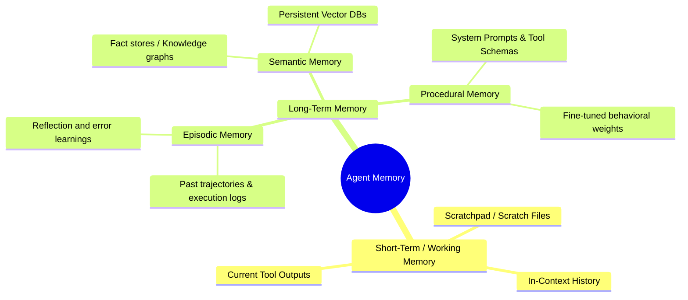

# Agentic Memory: Short-Term, Long-Term, and Working Memory

> **Definition**: Memory in AI agents refers to the computational mechanisms that store, retrieve, update, and forget information across interactions and task execution cycles.

---

## 1. Taxonomic Classification of Agent Memory

### A. Short-Term & Working Memory
- **Locus**: The active context window (e.g. 128k - 1M tokens) + local scratchpads.
- **Role**: Retains immediate conversational turns, current plan state, intermediate tool execution outputs.
- **Challenge**: Context drift, "needle in a haystack" attention degradation, context window expense.

### B. Long-Term Episodic Memory
- **Locus**: External persistent databases (vector embeddings, SQLite, JSON lines).
- **Role**: Records *what happened* in past sessions (e.g., "In session #42, attempting to install package X failed because of missing glibc dependencies").
- **Key Reference**: Generative Agents (Park et al., 2023) introduced the memory stream with recency, importance, and relevance retrieval scoring.

### C. Long-Term Semantic Memory
- **Locus**: Knowledge bases, markdown wikis (such as this `[[wiki/syntheses/ai-agent-anatomy|LLM Wiki]]`!), documentation stores.
- **Role**: General domain facts, conceptual syntheses, and invariant truth.

---

## 2. Memory Operations: Read, Write, Consolidate

1. **Write (Encoding)**: Appending events, tool results, user corrections.
2. **Retrieve (Recall)**:
   - Hybrid search: BM25 keyword matching + Dense Vector embedding similarity.
   - Time-decay weighting: prioritize recent relevant memories.
3. **Consolidation (Compacting / Reflection)**:
   - Periodically running a reflection loop to distill 50 granular tool logs into 3 generalized rules.
   - This prevents context bloating while preserving institutional knowledge.

---

## Cross-References
- Overarching Model: `[[wiki/syntheses/ai-agent-anatomy|The Anatomy of an AI Agent]]`
- Planning Interaction: `[[wiki/architectures/react-pattern|ReAct Pattern]]`
- Tool Execution: `[[wiki/concepts/tool-use-and-function-calling|Tool Use & Function Calling]]`
