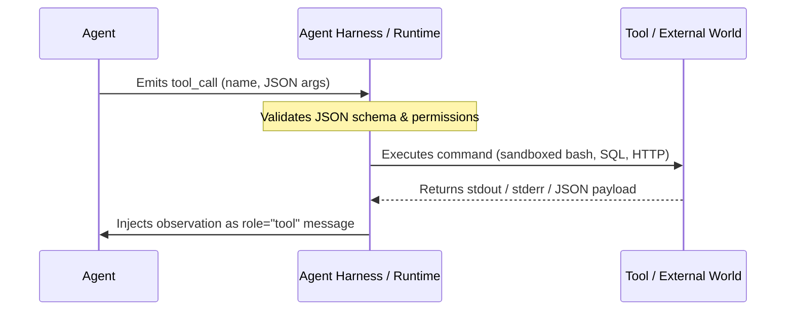

# Tool Use and Function Calling

> **Definition**: The mechanism that allows a language model to step outside its static training weights by generating structured invocations (e.g. JSON arguments) for external APIs, databases, sandboxes, and web services.

---

## 1. The Execution Protocol

1. **Declaration**: Tools are registered in the prompt using standardized JSON Schema (defining parameter types, required fields, and semantic descriptions).
2. **Invocation Decision**: The LLM predicts tokens representing a structured tool call instead of natural text.
3. **Execution Sandboxing**: The runtime intercepts the call, enforces security/permission boundaries, runs the code, and supplies the observation back into `[[wiki/concepts/agentic-memory|Agentic Memory]]`.

---

## 2. Evolution of Tool Protocols

- **Pre-2023 (Ad-hoc regex)**: Models were prompted to output strings like `Action: bash[ls -la]`, parsed with brittle regular expressions.
- **2023 (Native Function Calling)**: Frontier models (GPT-4, Claude, Gemini) trained with fine-tuned special tokens (`<tool_call>...`) for reliable JSON generation.
- **2024+ (Standardized Protocol - MCP)**: Anthropic introduced the **Model Context Protocol (MCP)**, standardizing client-server communication so agents can plug-and-play tools across systems without bespoke integration code.

---

## 3. Critical Failure Modes in Tool Use

- **Parameter Hallucination**: Inventing non-existent flags or arguments.
- **Massive Payload Blowout**: Running commands like `cat 500MB_log.txt` that blow out the context window. Solved by tools that enforce paginated reading and byte offsets.
- **Error Recovery Deficit**: Failing to adjust strategy when tools return non-zero exit codes. Overcome by structured `[[wiki/architectures/react-pattern|ReAct loops]]`.

---

## Cross-References
- Foundational Architecture: `[[wiki/syntheses/ai-agent-anatomy|The Anatomy of an AI Agent]]`
- Planning Loop: `[[wiki/architectures/react-pattern|ReAct Pattern]]`
- Framework Integration: `[[wiki/frameworks/langgraph|LangGraph]]`
