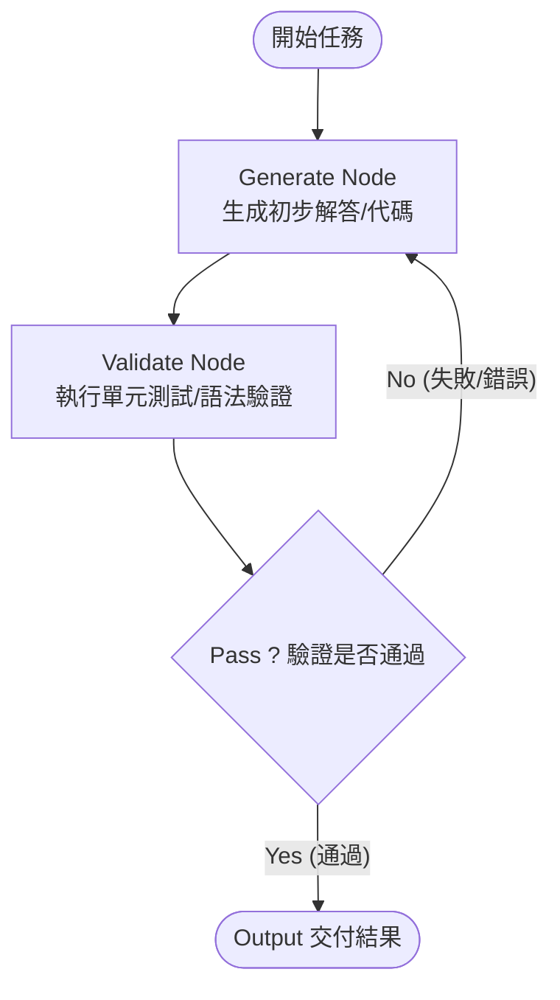

# LangGraph: Cyclical Multi-Agent State Machine

> **Definition**: LangGraph 是由 LangChain 團隊推出的狀態圖編排框架，專為克服線性 DAG 的局限而生。它將 Agent 與 Workflow 建模為具備**狀態（State）**、**節點（Node）**與**邊（Edge）**的有限狀態機，並天然支援具備自我修正能力的**循環反饋（Loops）**。

---

## 1. 核心哲學：Loops & Self-Correction (自我修正循環)

傳統流水線（如經典 DAG 鏈）假設執行為單向線性傳遞：$A \longrightarrow B \longrightarrow C$。  
但在現實的 Agentic 應用中，生成與驗證是持續迭代的：

- **Node（節點）**：執行具體運算（例如 Search Node、Generate Node、Validation Node）。
- **Edge / Conditional Edge（邊與條件邊）**：負責路由邏輯。
- **State（狀態）**：集中儲存整個執行流程的上下文與變更歷史。

---

## 2. Key Architecture Concepts

1. **State**: A shared, centrally typed schema (e.g., `TypedDict` or Pydantic model) that is passed to every node and mutated via explicit reducer functions.
2. **Nodes**: Python functions or runnable objects that take the current state, perform computation (e.g., LLM inference, tool execution), and output state updates.
3. **Edges & Conditional Edges**: Routing logic that dictates transition to the next node based on state values (e.g., branching if `has_tool_call` vs `is_finished`).
4. **Persistence & Checkpointing**: LangGraph persists state at every step, enabling:
   - Time-travel debugging (replaying steps)
   - Human-in-the-loop approval breakpoints
   - Resuming crashed long-running agents

---

## 3. Comparison with Other Frameworks

| Framework | Core Metaphor | Cyclic Loops? | State Management | Primary Strength |
| :--- | :--- | :--- | :--- | :--- |
| **LangGraph** | Finite State Machine (Graph) | Native & explicit | Centralized typed state & checkpointers | High control, production determinism |
| **CrewAI** | Role-playing personas & crews | Implicit | Task-driven handoffs | Rapid prototyping of role-based teams |
| **AutoGen** | Conversational chat between agents | Implicit (via chat turns) | Distributed conversational context | Multi-agent collaborative dialogue |

---

## Cross-References
- 工作流 vs Agent：`[[wiki/architectures/workflows-vs-agents|Workflows vs. Agents]]`
- 編排核心：`[[wiki/concepts/agent-orchestrator|Agent Orchestrator]]`
- 基礎架構總覽：`[[wiki/syntheses/ai-agent-anatomy|The Anatomy of an AI Agent]]`
- 推理循環：`[[wiki/architectures/react-pattern|ReAct Pattern]]`
- 工具調用：`[[wiki/concepts/tool-use-and-function-calling|Tool Use & Function Calling]]`
