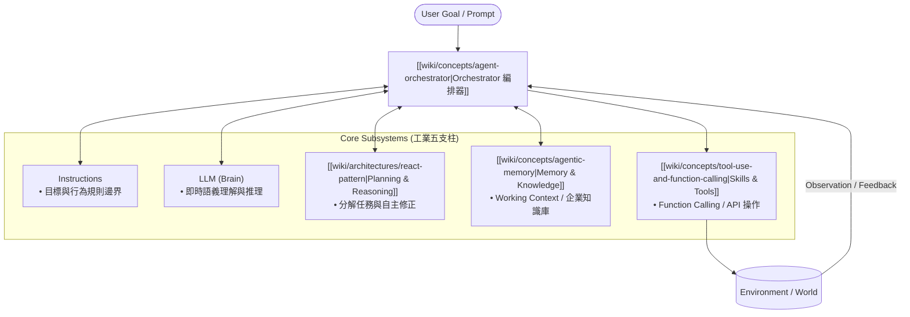

# The Anatomy of an AI Agent: 工業級結構與定義

> **Core Thesis**: AI Agent 不再僅是單向產生文字的語言模型，而是一個具備自主決策能力的運算系統。LLM 作為核心推理引擎（*Brain*），與 **Instructions**、**Orchestrator**、**Memory/Knowledge** 以及 **Skills/Tools** 緊密協作，感知環境並執行具備狀態轉移的任務。

---

## 1. 工業級經典架構公式 (Microsoft & OpenAI)

### A. Microsoft 定義公式
$$\mathbf{Agent} = \text{Instructions} + \text{LLM} + \text{Knowledge} + \text{Skills} + \mathbf{Orchestrator}$$

- **Instructions**：定義代理人的角色身份、防護邊界與執行目標。
- **LLM**：提供即時推理能力與語義理解。
- **Knowledge**：企業數據庫、郵件、會議紀錄、即時上下文。
- **Skills**：排程會議、呼叫 API、修改文件、建立工單。
- **Orchestrator**：協調整個工作流的調度核心（參見 `[[wiki/concepts/agent-orchestrator|Agent Orchestrator]]`）。

### B. OpenAI 定義特徵：從 Chatbot 到 Workflow Management
OpenAI 指出，Agent 的本質**不是聊天，而是工作流程管理（Workflow Management）**：
1. **Autonomy（自主性）**：自主推進任務，不需人類逐步引導。
2. **Tool Use（工具調用）**：主動調度外部系統執行真實世界的修改。
3. **Task Execution（任務執行）**：完整管理「目標 $\to$ 規劃 $\to$ 選擇工具 $\to$ 執行 $\to$ 驗證」的閉環。

---

## 2. Agent Paradigm Shift: Prompting vs. Workflows vs. Agents

| 維度 | Zero-Shot Prompting | Deterministic Workflow | Autonomous Agent |
| :--- | :--- | :--- | :--- |
| **運作本質** | 單次前向推論生成文字 | 代碼固化之固定流水線（A $\to$ B $\to$ C） | 具有動態決策與循環修正能力之閉環 |
| **反饋適應** | 無（單點輸出） | 依賴工程師寫好的 Fallback | 透過 `[[wiki/architectures/react-pattern|ReAct Loop]]` 與驗證自我修復 |
| **詳盡對比** | — | 詳見 `[[wiki/architectures/workflows-vs-agents|Workflows vs. Agents]]` | 詳見 `[[wiki/frameworks/langgraph|LangGraph]]` |

---

## 3. Evaluation & Verification

相較於靜態考試（MMLU, GSM8k），Agent 的唯一評測標準是「**真實環境任務達成率**」：
- 軟體工程維度：透過 `[[wiki/evals/swe-bench|SWE-bench]]` 評測修復真實 GitHub Issue 的 Patch 質量與測試通過率。
- 企業落地維度：Microsoft Copilot Studio 著重於跨應用自動化整合與「數位員工」協同表現。

---

## Related Links
- 架構對比：`[[wiki/architectures/workflows-vs-agents|Workflows vs. Agents]]`
- 編排核心：`[[wiki/concepts/agent-orchestrator|Agent Orchestrator]]`
- 循環模式：`[[wiki/architectures/react-pattern|ReAct Pattern]]`
- 記憶架構：`[[wiki/concepts/agentic-memory|Agentic Memory]]`
- 工具呼叫：`[[wiki/concepts/tool-use-and-function-calling|Tool Use & Function Calling]]`
- 狀態圖框架：`[[wiki/frameworks/langgraph|LangGraph]]`
- 實戰評測：`[[wiki/evals/swe-bench|SWE-bench]]`
