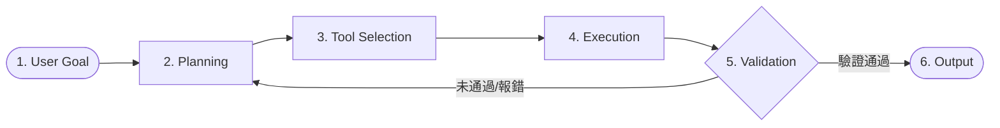
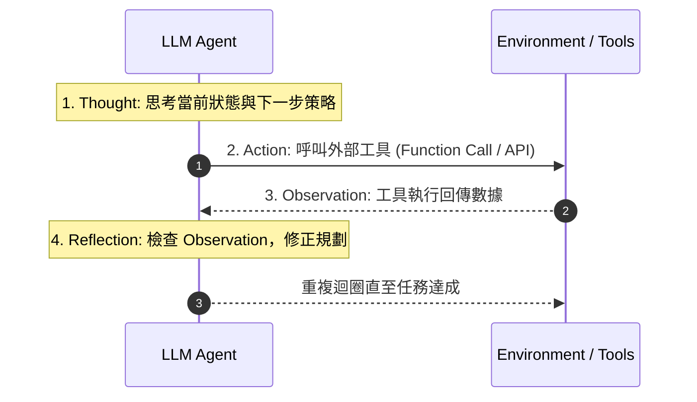
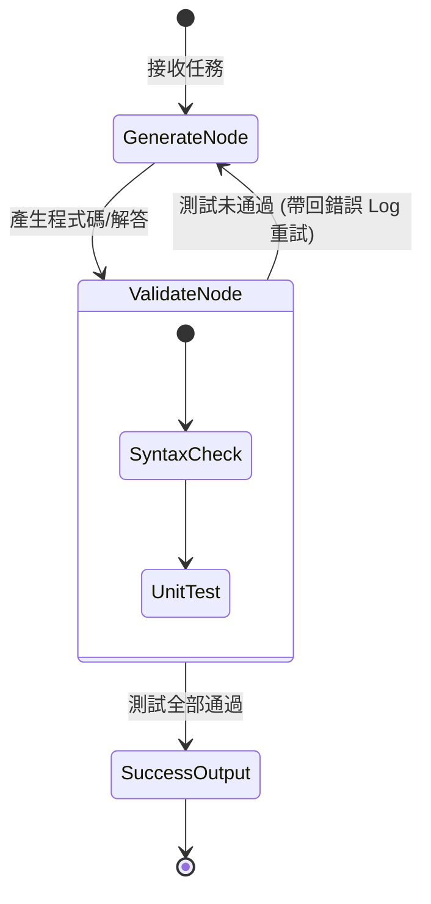

<!-- _class: lead -->

# AI AGENT
## 從對話機器人到自主數位員工的典範轉移

**An Executive Guide to Agentic Systems, Architectures, and Workflows**

報告人：AI Agent Wiki 架構維護團隊  
知識庫：`[[index|AI Agent LLM Wiki]]`

<!-- _note: 各位好，今天這份簡報將帶大家跳脫「ChatGPT 純聊天」的思維，深入探討當前科技巨頭（OpenAI、Microsoft、Anthropic、LangGraph）共同定義的全新物種——AI Agent。我們將從底層架構、關鍵公式、閉環工作流到企業落地實踐進行全方位解析。 -->

---

# 1. 什麼是 AI Agent？（核心定義）

傳統的大型語言模型是**文字生成器**；而 AI Agent 則是**具備自主決策與執行能力的運算系統**。

- **不只是聊天（Not Just a Chatbot）**：超越問答，能夠自主管理完整工作流程。
- **目標導向（Goal-Oriented）**：接收高層級目標（User Goal），自主拆解子步驟。
- **環境操作（Environment Grounding）**：透過 API、資料庫與工具直接改變現實世界狀態。
- **自我修正（Self-Correction）**：在執行遭遇失敗或錯誤時，具備動態調整策略的能力。

> 深入閱讀：`[[wiki/syntheses/ai-agent-anatomy|The Anatomy of an AI Agent]]`

<!-- _note: 請大家記住這句核心結論：Agent 的本質不是語言模型的文字能力，而是工作流管理與自主性。它不是被動回答你的問題，而是代理你走完一整套複雜任務。 -->

---

# 2. 關鍵分水嶺：Workflow vs. Agent

Anthropic 與 LangGraph 特別強調：打造有效 AI 系統的第一步，是釐清何時用 **Workflow**，何時用 **Agent**。

| 維度 | Workflow（確定性工作流） | Agent（自主動態代理） |
| :--- | :--- | :--- |
| **執行路徑** | 固定的 DAG 流水線（$A \to B \to C$） | 動態評估下一步，路徑在運行時生成 |
| **主控權** | 代碼驅動（Code-driven） | 模型驅動決策（Model-driven） |
| **錯誤處理** | 預設 Fallback / 程式例外捕捉 | 自主反思驗證（Reflection Loop） |
| **最佳場景** | 高標準、可預測的流水線作業 | 探索型任務、複雜除錯、不確定環境 |

> 深入閱讀：`[[wiki/architectures/workflows-vs-agents|Workflows vs. Agents]]`

<!-- _note: 業界常犯的錯誤是「拿大砲打小鳥」，把固定邏輯的任務硬做成不可控的 Agent。Anthropic 明確提醒：不要過度工程化，最棒的架構通常是確定性工作流與局部動態 Agent 的優雅組合。 -->

---

# 3. 工業級經典架構公式 (Microsoft)

Microsoft 在其官方架構設計指南中，給出了最權威的 **Agent 5 大支柱公式**：

$$\mathbf{Agent} = \text{Instructions} + \text{LLM} + \text{Knowledge} + \text{Skills} + \mathbf{Orchestrator}$$

- **Instructions（規則指令）**：定義 Agent 的角色身分、安全防護與業務限制。
- **LLM（語言模型大腦）**：提供即時推理能力與語意理解引擎。
- **Knowledge（知識來源）**：企業內部文件、郵件、會議紀錄、即時資料庫。
- **Skills（技能與行動）**：調用外部 API、排程日曆、發送訊息、建立工單。
- **Orchestrator（編排器）**：決定下一步的調度中樞（大腦中控）。

> 深入閱讀：`[[wiki/concepts/agent-orchestrator|Agent Orchestrator]]`

<!-- _note: 這個公式非常好記，五個元素缺一不可。LLM 只是引擎，沒有 Instructions 它不知道規則；沒有 Knowledge 它缺乏領域事實；沒有 Skills 它沒有手腳；沒有 Orchestrator 它無法串聯任務。 -->

---

# 4. Agent 的六步自主運作閉環 (OpenAI & Anthropic)

OpenAI 指出，一個標準的 Agent 執行閉環包含六個關鍵階段：

1. **User Goal**：接收高階目標。
2. **Planning**：分解任務，規劃子步驟（Chain of Thought）。
3. **Tool Selection**：評估並挑選最適當之工具 API。
4. **Execution**：沙盒執行，獲取環境回傳結果（Observation）。
5. **Validation & Reflection**：驗證是否滿足條件，自主決定重試或微調。
6. **Output**：完成交付任務。

<!-- _note: 傳統 Chatbot 在第 4 步就結束了，把 raw output 直接拋給人類。而 Agent 的真正價值在於第 5 步「Validation」——它會檢查執行結果對不對，不對就自己修復重新執行，直到交付合格成果。 -->

---

# 5. 核心推理機制：ReAct 迴圈架構

Yao et al. (2022) 奠定的 **ReAct (Reasoning + Acting)** 是當今所有 Agent 的核心基礎：

- **單純推理（CoT）**：容易在封閉脈絡中產生幻覺（Hallucination）。
- **單純行動（Acting）**：缺乏大局觀與長遠步驟規劃。
- **ReAct 協同**：思考引導行動，行動觀察驗證思考，形成閉環。

> 深入閱讀：`[[wiki/architectures/react-pattern|ReAct Pattern]]`

<!-- _note: ReAct 解決了大模型最致命的兩個問題：幻覺與無法與外部系統同步。每次 Action 都在將推理落地到現實世界，每次 Observation 都在校正模型的幻覺。 -->

---

# 6. 工具調用與標準化：Function Calling 到 MCP

工具（Tools & Skills）是 Agent 的「手與腳」：

- **Function Calling 機制**：
  - 透過標準 **JSON Schema** 定義參數型別、必填項與語義說明。
  - 模型預測結構化呼叫指令，而非直接輸出不可控的文字。
- **現代協議演進：Model Context Protocol (MCP)**：
  - 由 Anthropic 主導，成為串接 AI 與企業內部工具的通用標準。
  - 解耦客戶端與服務端，一次開發即可跨平台支援。
- **安全沙盒（Sandbox Execution）**：
  - 限制檔案系統權限、網路存取與超時監控，避免不可逆的破壞性操作。

> 深入閱讀：`[[wiki/concepts/tool-use-and-function-calling|Tool Use & Function Calling]]`

<!-- _note: 工具呼叫經歷了三個世代：最初是脆弱的正則表達式，接著是 OpenAI 引領的原生 Function Calling，現在則走向開放跨平台的 MCP 標準協議。 -->

---

# 7. 記憶體系架構：Agent 如何記住世界？

Agent 具備多層級的記憶系統（Memory Hierarchy）：

- **工作記憶（Working Memory）**：
  - 當前的 Context Window 與 Scratchpad。
  - 儲存當前會話、即時規劃狀態與最近幾次的工具輸出。
- **情節記憶（Episodic Memory）**：
  - 記錄歷史執行軌跡、成功案例與除錯經驗（「上次遇到套件衝突時，解決方案是...」）。
- **語義與企業知識庫（Semantic Memory）**：
  - 向量資料庫（RAG）、Graph RAG、以及如本維基般的持久化 Markdown Wiki。
- **記憶壓縮與沉澱（Consolidation）**：
  - 定期透過反思將 50 筆零散對話提煉為 3 條長效規則，避免 Context 爆發。

> 深入閱讀：`[[wiki/concepts/agentic-memory|Agentic Memory]]`

<!-- _note: 許多人以為 Context Window 變大就不需要記憶系統了，這是誤解。Context 越大不僅越貴，注意力也容易渙散。高階 Agent 必然仰賴結構化的長短期記憶分層機制。 -->

---

# 8. 狀態機與循環實戰：LangGraph 架構

在生產環境中，如何讓 Agent 具備自我修復能力而不陷入無窮迴圈？

- **三大核心元素**：
  - **Node（節點）**：獨立邏輯處理單元（檢索、生成、驗證）。
  - **Edge（條件邊）**：由程式或 LLM 決定下一步流轉。
  - **State（狀態）**：全域不可變狀態管理，支援時間旅行除錯（Time Travel）。

> 深入閱讀：`[[wiki/frameworks/langgraph|LangGraph]]`

<!-- _note: LangGraph 的核心思想是 Finite State Machine（有限狀態機）。它讓開發者能在嚴格控制的安全框架下，賦予 LLM 局部的自主修正權限。 -->

---

# 9. 四大巨頭的 Agent 戰略視角對比

各大技術領袖在 Agent 的落地上各有側重點：

| 廠商 / 框架 | 核心定位 | 獨特主張與架構重點 |
| :--- | :--- | :--- |
| **OpenAI** | 實用工作流管理 | 強調自主性（Autonomy）、工具調用與任務完成驗證。 |
| **Microsoft** | 企業級「數位員工」 | 提出 $\text{Inst} + \text{LLM} + \text{Know} + \text{Skill} + \text{Orch}$ 公式；Copilot Studio。 |
| **Anthropic** | 極簡有效架構 | 提倡「不追求複雜無序自主」，推崇簡約可組合模式與 MCP 協議。 |
| **LangGraph** | 循環狀態機編排 | 以 Graph 與 State 管理 Loops，解決傳統 DAG 無法自我修正的致命傷。 |

> 深入閱讀：`[[wiki/architectures/workflows-vs-agents|Workflows vs. Agents]]`

<!-- _note: 這張矩陣非常重要。微軟看重的是企管協同與數位員工；Anthropic 提醒工程師回歸簡單有效；LangGraph 補足了工程實作層的狀態循環問題；OpenAI 則樹立了任務自主性的標竿。 -->

---

# 10. 企業落地：數位員工（Digital Employee）應用場景

在 Microsoft Copilot Studio 與企業應用中，Agent 的四大高價值領域：

- **智慧研發與軟體工程（Coding Agents）**：
  - 自主閱讀龐大 Repo、重現 Bug、撰寫修復 Patch、執行單元測試（如 `[[wiki/evals/swe-bench|SWE-bench]]`）。
- **跨系統企業流程自動化（Enterprise Automation）**：
  - 貫穿 ERP、CRM、Email 與 Slack，自動完成發票核銷、商機推進與工單排程。
- **深度研究與知識合成（Autonomous Research）**：
  - 自主網頁搜尋、過濾高質量論文、綜合萃取並維護企業持久維基（LLM Wiki）。
- **多代理人協同團隊（Multi-Agent Swarms）**：
  - 產品經理 Agent $\to$ 架構師 Agent $\to$ 測試 Agent 協同交付專案。

<!-- _note: Agent 正在將過去「只能靠人工手動點擊幾十個系統」的低效作業轉化為全自動的協作網路。這也是為什麼各大企業將 Agent 視為未來三年的關鍵投資方向。 -->

---

# 11. 落地挑戰與工程實務邊界

構建 Agent 系統時必須防範的四大工程陷阱：

1. **死循環陷阱（Infinite Loops）**：
   - 工具持續報錯時，模型反覆發出相同請求。$\to$ **解法**：設定最大迭代次數（Max Iterations）與衰減反思。
2. **上下文膨脹（Context Bloating）**：
   - 龐大終端機 Log 或搜尋結果灌爆 Context Window。$\to$ **解法**：分頁截斷讀取、結構化摘要再輸入。
3. **安全防護邊界（Safety Boundaries）**：
   - 越權執行破壞性命令。$\to$ **解法**：敏感操作強制加入 **Human-in-the-Loop** 審批閘門。
4. **評測基準轉變**：
   - 拋棄靜態問答評測，採用動態沙盒任務評測（`[[wiki/evals/swe-bench|SWE-bench]]`）。

<!-- _note: 真正的生產級 Agent 開發，80% 的精力都在處理這四個邊界問題。唯有建立健全的安全審批與超時機制，Agent 才能安全進入企業生產環境。 -->

---

<!-- _class: lead -->

# 12. 總結與核心結論

1. **定義轉移**：Agent 的核心是 **工作流管理、工具調用與自主閉環**，而非單純聊天對話。
2. **架構公式**：$\text{Agent} = \text{Instructions} + \text{LLM} + \text{Knowledge} + \text{Skills} + \text{Orchestrator}$。
3. **工程原則**：先確立確定性 **Workflow**，再在不確定性關鍵節點引入具備自我修正的 **Agent**。
4. **知識沈澱**：透過持久化的知識庫體系（LLM Wiki），讓每次任務與探索成果持續複利累積！

---

<!-- _class: lead -->

# Q & A

**歡迎深入查閱知識庫：**
- 總目錄：`[[index|AI Agent LLM Wiki Index]]`
- 基礎架構：`[[wiki/syntheses/ai-agent-anatomy|The Anatomy of an AI Agent]]`
- 工作流對比：`[[wiki/architectures/workflows-vs-agents|Workflows vs. Agents]]`
- 狀態循環：`[[wiki/frameworks/langgraph|LangGraph State Machine]]`

*Thank you!*
