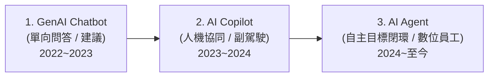

# Real-World Applications of AI Agents: 產業落地全景與實務分析

> **核心綜述**：AI Agent 的演進標誌著人工智慧從「純語言生成（Text Generation）」正式跨越到「自主行動與任務閉環（Action & Task Execution）」。在現實世界的商業化與工程實踐中，Agent 正在軟體研發、企業流程、深度情報研究、客戶支援與垂直高價值領域帶來顛覆性的生產力躍遷。

---

## 1. 落地光譜：從 Chatbot 到 Copilot 再到 Agent

- **Chatbot**：單次前向生成，無法碰觸外部系統，人類負擔全部執行。
- **Copilot**：內嵌於 IDE 或 Office 介面中輔助人類，需人類逐步點擊確認。
- **Agent**：以 `[[wiki/concepts/agent-orchestrator|Agent Orchestrator]]` 為中樞，具備自主拆解任務、呼叫工具、自我修正的完整行動閉環。

---

## 2. 五大主流現實落地領域

### 2.1 軟體工程與自主編程 (Software Engineering)
- **代表系統**：Cursor Agent, Devin, GitHub Copilot Workspace。
- **關鍵機制**：基於 `[[wiki/architectures/react-pattern|ReAct Loop]]` 讀取大型 Codebase、利用 AST/Grep 追蹤錯誤堆疊，在沙盒終端機內運行單元測試，若報錯則自我修正直到 Pass，最後生成 Git Diff Patch。
- **工業評測**：以 `[[wiki/evals/swe-bench|SWE-bench]]` 衡量真實 GitHub Issue 解決能力。

### 2.2 企業流程自動化與數位員工 (Enterprise Workflows)
- **代表系統**：Microsoft Copilot Studio, Salesforce Agentforce, SAP Joule。
- **落地公式**：
  $$\mathbf{Agent} = \text{Instructions} + \text{LLM} + \text{Knowledge} + \text{Skills} + \mathbf{Orchestrator}$$
- **業務場景**：跨 ERP / CRM / HR / Email 系統自動化，如廠商發票自動審核與過帳、員工入職自動開通 IT 權限與排程。

### 2.3 深度情報分析與自主研究 (Deep Research)
- **代表系統**：OpenAI Deep Research, Perplexity Pro, 以及本維基採用的 `LLM Wiki Pattern`。
- **核心能力**：多跳檢索（Multi-Hop Search）、交叉驗證來源數據、自動維護持續複利的雙向連結知識庫。

### 2.4 智慧客戶支援與自主解決 (Autonomous Support)
- **跨越傳統 FAQ**：不再只是提供罐頭說明連結，而是具備即時 API 操作權限（查詢訂單物流、調用退款 API、修改訂閱方案）。
- **人機協同分流**：超過特定金額門檻時自動觸發 Human-in-the-Loop 審批。

### 2.5 垂直專業領域 (金融 / 法律 / 醫療)
- **金融**：自動化 10-K 財報拆解、即時反洗錢交易監測。
- **法律**：Harvey AI 輔助合約條款風險標註、跨國 GDPR/AI 法規遵循。
- **生醫**：癌症患者病歷與全球最新臨床試驗受試條件智慧匹配。

---

## 3. 多代理人協同團隊 (Multi-Agent Swarms)

當複雜任務超出單一模型 Context Window 與能力邊界時，業界轉向組織級 Multi-Agent：
- **職責解耦 (Separation of Concerns)**：PM Agent $\to$ Architect Agent $\to$ Dev Agent $\to$ QA Agent。
- **狀態機編排**：以 `[[wiki/frameworks/langgraph|LangGraph]]` 建立條件跳轉與審查循環，QA 測試失敗時退回 Dev Agent 重寫。

---

## 4. 生產級落地安全護欄 (Guardrails)

1. **最小權限原則 (Least Privilege)**：查詢工具全面開放，寫入/刪除工具嚴格管控。
2. **沙盒隔離 (Containerized Sandboxes)**：代碼與命令強制在 Docker / E2B 隔離容器中執行。
3. **熔斷與超時機制**：設定最大迭代次數（如 25 輪），防範無限死循環。
4. **Human-in-the-Loop (HITL)**：重大財務、對外通訊操作強制引入人類單擊確認。

---

## 交付成果
- 互動式展示簡報 HTML：`[[presentations/ai-agent-real-world-applications.html|瀏覽簡報]]`
- Marp 格式投影片：`[[wiki/syntheses/presentation-ai-agent|AI AGENT 權威架構與落地指南 (Marp)]]`

## 相關筆記
- 基礎架構總覽：`[[wiki/syntheses/ai-agent-anatomy|The Anatomy of an AI Agent]]`
- 確定性工作流對比：`[[wiki/architectures/workflows-vs-agents|Workflows vs. Agents]]`
- 編排核心：`[[wiki/concepts/agent-orchestrator|Agent Orchestrator]]`
- 狀態循環：`[[wiki/frameworks/langgraph|LangGraph]]`
- 實戰評測：`[[wiki/evals/swe-bench|SWE-bench]]`
